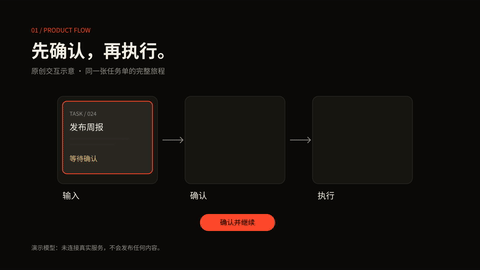
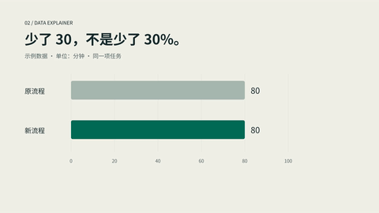
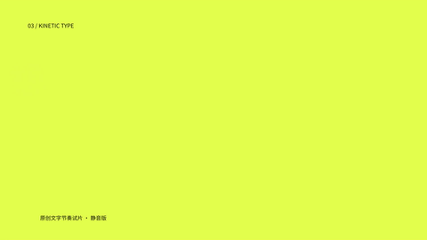
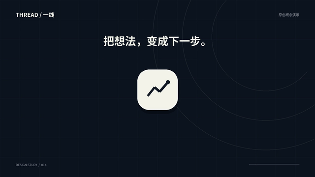
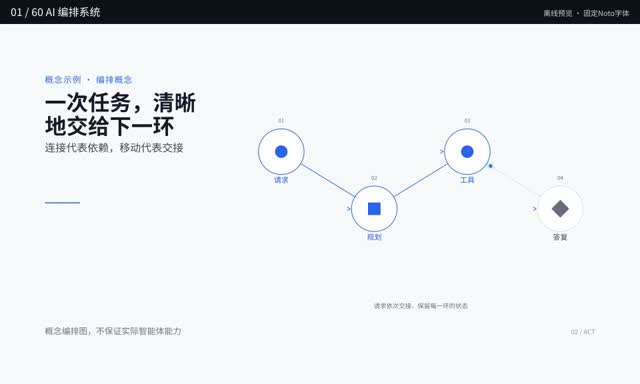
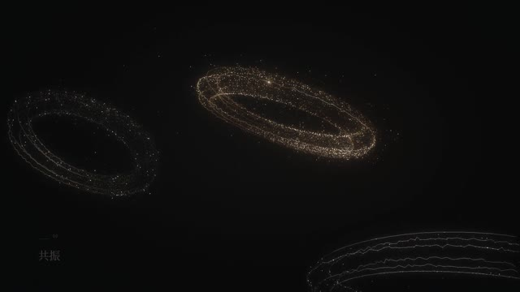
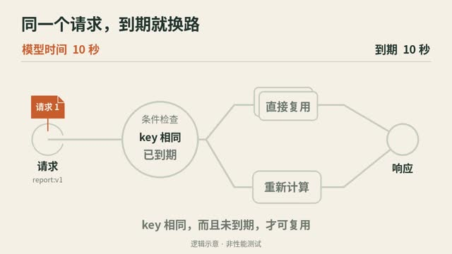
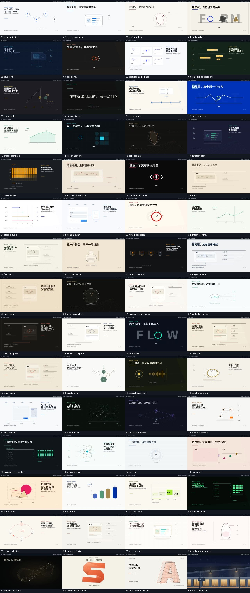

# 视频创作 Skill · 60 风格

[English](README.md) · **简体中文**

**把你的文案、产品流程和知识解释，变成可以继续修改的视频工程。**

60 套风格 · 横竖屏 · 配音字幕 · 透明动画 · 实拍叠加

[下载 ZIP](https://github.com/LTX2022/video-creation-skill/archive/refs/heads/main.zip) · [安装](#下载与安装) · [做第一条视频](#做出第一条视频15-秒产品流程) · [完整指南](web-video-presentation/README.zh-CN.md)

## 先看效果

**中文界面 · 三条各 12 秒 · 1080p30 · 静音**

| 产品流程 | 数据解释 | 动态排版 |
|:---:|:---:|:---:|
| [](media/samples-20261102/zh-CN/product.mp4) | [](media/samples-20261102/zh-CN/data.mp4) | [](media/samples-20261102/zh-CN/type.mp4) |
| [打开 MP4](media/samples-20261102/zh-CN/product.mp4) | [打开 MP4](media/samples-20261102/zh-CN/data.mp4) | [打开 MP4](media/samples-20261102/zh-CN/type.mp4) |

上方是动态 GIF 预览，不是内嵌 MP4 播放器。点击打开成片；GitHub 无播放器时选择 **Download raw file**。这六个中英文版本通过 React/SVG → librsvg/Cairo → FFmpeg 离线路线生成，**不代表 Remotion 浏览器渲染链已通过**。数据为教学假设。已完成全程解码与抽帧目视检查，未做真人实时完整播放或用户验收。三条 12 秒示范不是下方的 15 秒入门练习。[来源与验证](media/samples-20261102/README.md)

<details>
<summary><strong>历史中文参考样片与 60 风格总览</strong></summary>

### 历史中文样片

[](media/thread-continuity-14s.mp4)

**THREAD / 一线 · 14 秒 · 有声** — 同一个面板，从输入变成结果，再收束为图标。[打开完整 MP4](media/thread-continuity-14s.mp4)

| 60 风格总览 · 6:24 | 从噪声到秩序 · 26 秒 | 缓存边界 · 14 秒 |
|:---:|:---:|:---:|
| [](media/60-styles-noto-overview.mp4) | [](media/order-emergent-26s.mp4) | [](web-video-presentation/examples/semantic-cache-study/semantic-cache-boundary.mp4) |
| [打开 MP4](media/60-styles-noto-overview.mp4) | [打开 MP4](media/order-emergent-26s.mp4) | [打开 MP4](web-video-presentation/examples/semantic-cache-study/semantic-cache-boundary.mp4) |

点击图片打开 MP4 文件页；若无播放器，点 **Download raw file** 下载播放。首页动态图片是无声 GIF，**不是内嵌 MP4 播放器**。后三条视频为静音；风格总览来自 React/SVG，其他为 Python 自生成试片。[来源与复现](media/README.md)

<details>
<summary><strong>展开看全部 60 套风格</strong>（真实总览截图，按视频顺序排列）</summary>

[](media/60-styles-noto-overview.mp4)

[风格名称、用途与视频时间](media/preview-source/index.json) · [全部主题源码](web-video-presentation/themes/)

</details>


</details>

## 适合做什么

| 你提供 | 用它制作 |
|---|---|
| 文章、讲解稿 | 分镜、口播、句级字幕与横竖屏视频 |
| 产品流程、操作逻辑 | UI 演示、流程动画与连续对象变形 |
| 数据、机制、概念 | 因果关系、状态变化和知识解释动画 |
| 已授权实拍素材 | 透明动态图形及画面叠加 |

这是供**支持加载 Skill，且能读写文件、运行代码的 AI Agent**使用的工具，不是独立剪辑软件。不同 Agent 的安装方式与权限可能不同。工作流程是：**选风格 → 确认分镜与关键画面 → 预览 → 渲染与检查 → 交付视频和源码**。安装 Skill 不等于装好渲染环境。

## 下载与安装

**[下载完整公开版 ZIP](https://github.com/LTX2022/video-creation-skill/archive/refs/heads/main.zip)**，或点本页绿色 **Code → Download ZIP**，解压后得到 `video-creation-skill-main`。

ZIP 包含完整公开版 Skill、60 套风格源码、10 个 MP4（4 条历史片，以及 3 种新示例的中英文版本） 与可选 `fix-agent`。依赖、模型服务及旧研究抽帧/转写/蒸馏工具不附；不是历史原始总包。

### 安装到你的 Agent

解压下载的 ZIP，在你使用的 Agent 中发送：

> 请把我解压的 video-creation-skill 里的 web-video-presentation 文件夹安装为技能。先检查你的技能安装方式；如果需要我提供目录或确认权限，请告诉我。安装完成后确认技能可以被识别。

根据 Agent 的提示提供解压目录即可。需要能读取文件和安装技能的 Agent；各平台的操作、权限及依赖可能不同。如果 Agent 不支持安装技能，可参考该平台说明加载完整文件夹。

## 做出第一条视频：15 秒产品流程

在你选择的 **兼容 Agent 的对话中**提出需求。环境、权限和依赖满足后，Agent 可以负责检查环境、创建工程、写代码和渲染；你负责确认方案与观看结果。

### 1. 告诉 Agent 要做什么

确认 `web-video-presentation` 已安装并启用，复制这段，填入项目目录：

```text
使用 web-video-presentation 做一条 15 秒产品流程视频。
内容：输入任务 → 生成三步计划 → 逐项标记完成。
规格：1920×1080、30 fps、静音，保留界面内中文。
只用原创图形，不调用付费服务。
项目目录：[填写你确认的独立空目录绝对路径]。
先推荐 3 套风格，给出三段分镜和关键画面方案。
我确认后再制作；最终需要 MP4 和可编辑源码。
```

**你会先看到：** 风格建议、0–5 / 5–10 / 10–15 秒分镜，以及需要你确认的环境或素材事项，而不是直接生成整片。首次练习的执行说明随 Skill 一起安装，由 Agent 按需读取。

### 2. 选方案，确认首段制作

```text
选择 ai-orchestration，确认这份三段分镜。
请在指定目录制作，缺依赖先说明安装来源和位置，等我确认。
先给我关键画面；我确认后再输出前 5 秒连续视频预览。
```

**你需要看：** 中文是否正确、画面布局是否合适、动作和节奏是否连贯。Agent 应提供可打开的预览文件，不用截图合集冒充视频。缺工具、素材或权限时，先说明阻塞，不自动绕过。

### 3. 直接说哪里要改

例如：

```text
结果卡片晚 0.5 秒出现，标题保留到第 5 秒。
保持总长 15 秒，修改后重新给我看首段。
```

满意后再说：

```text
首段确认。按分镜完成其余两段，保持同一风格和总时长。
展示新增关键画面，我确认后再渲染完整 MP4。
```

**你会得到：** 完整的 15 秒成片及实际文件路径。Agent 负责渲染和技术检查，你从头到尾观看内容、文字、节奏和首尾停留。

### 4. 确认成片，拿走视频与源码

```text
确认这版成片。请核验时长、分辨率和帧率，整理 MP4 与源码交付包。
先列明源码、素材和排除项；不要包含密钥或未授权素材。
交付时给我视频和 ZIP 的实际路径，说明如何继续修改及尚未验证的部分。
```

Agent 会告知视频和源码包的实际保存位置，并说明如何继续修改。交付包不是默认包含全部原始素材，也不等于已在另一台电脑验证可运行。

想做口播视频，补充文案、声音和字幕要求；想要透明动画或实拍叠加，直接说明所需素材和输出。Agent 应按对应路线执行，而不是照搬本例静音流程。[输出与交付说明](web-video-presentation/DELIVERY.md)

## 项目与说明

```text
web-video-presentation/  主 Skill：SKILL.md、脚本、模板、themes/、examples/
fix-agent/               可选的排错与复盘 Skill
media/                   视频、预览与来源说明（缓存示例在 examples/ 下）
docs/                    验证记录
```

**已完成的验证：** 已制作并检查 4 条历史片与 6 个中英文新样片文件，范围以各自记录为准；完成代码测试、独立脚手架 typecheck/bundle 和视频完整解码检查。样片的具体制作方式见[来源与复现](media/README.md)。不同 Agent、系统及输出路线的兼容情况，以各自测试记录为准。[详细记录](docs/VALIDATION.md)

原创代码的 MIT 范围见 [LICENSE-SCOPE](LICENSE-SCOPE.md)；视频、字体与第三方内容不自动适用 MIT。[第三方说明](THIRD_PARTY_NOTICES.md)
