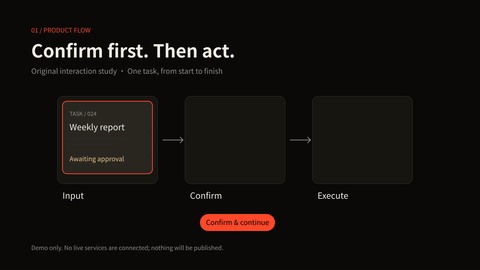
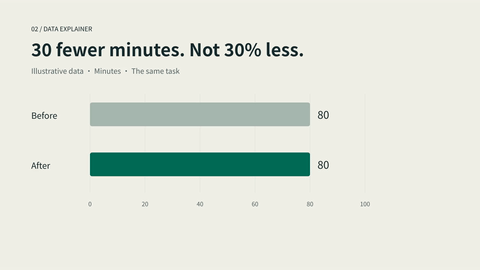
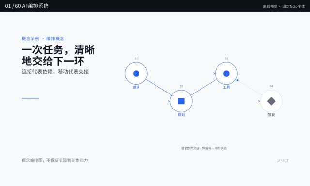
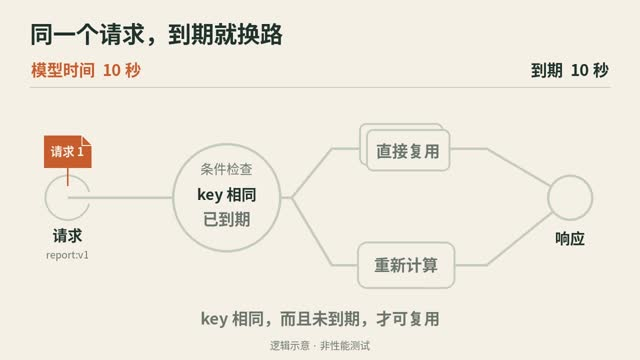
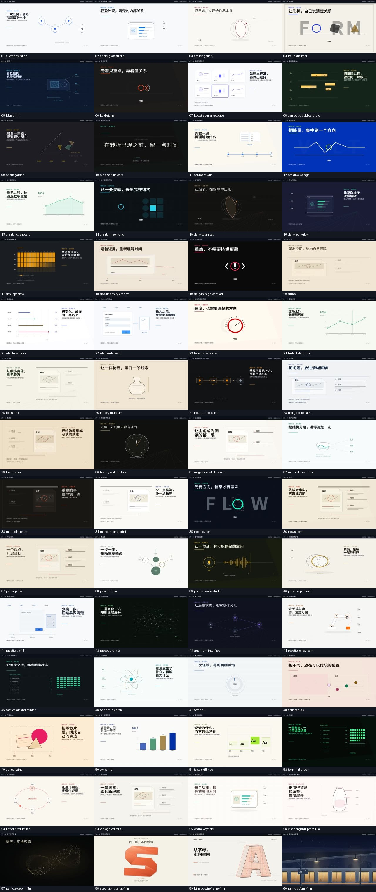

# Video Creation Skill

**Turn scripts, product workflows, and explanations into videos you can keep editing.**

Extensible visual styles · Landscape and portrait · Voiceover and subtitles · Transparent animation · Live-action overlays

**English** · [简体中文](README-CN.md)

[Download ZIP](https://github.com/LTX2022/video-creation-skill/archive/refs/heads/main.zip) · [Install](#download-and-install) · [Make your first video](#make-your-first-video-a-15-second-product-workflow) · [Full guide (Chinese)](web-video-presentation/README.zh-CN.md)

## See it in action

**English on-screen text · Three 12-second samples · 1080p30 · Silent**

| Product workflow | Data explanation | Kinetic typography |
|:---:|:---:|:---:|
| [](media/samples-20261102/en/product.mp4) | [](media/samples-20261102/en/data.mp4) | [](media/samples-20261102/en/type.mp4) |
| [Open MP4](media/samples-20261102/en/product.mp4) | [Open MP4](media/samples-20261102/en/data.mp4) | [Open MP4](media/samples-20261102/en/type.mp4) |

These are animated GIF previews, not embedded MP4 players. Click to open each MP4; if GitHub shows no player, choose **Download raw file**.

<details>
<summary><strong>Earlier reference examples — Chinese on-screen text</strong></summary>

These older examples are Chinese-language references, not demonstrations of English-language output.

### Earlier examples — Chinese on-screen text

[](media/thread-continuity-14s.mp4)

**THREAD / 一线 · Chinese on-screen text · 14 seconds · With audio** — One panel transforms from an input into a result, then resolves into an icon. [Open the full MP4](media/thread-continuity-14s.mp4)

| Built-in style overview · 6:24 | From noise to order · 26 seconds | Cache boundaries · 14 seconds |
|:---:|:---:|:---:|
| [](media/60-styles-noto-overview.mp4) | [](media/order-emergent-26s.mp4) | [](web-video-presentation/examples/semantic-cache-study/semantic-cache-boundary.mp4) |
| [Open MP4](media/60-styles-noto-overview.mp4) | [Open MP4](media/order-emergent-26s.mp4) | [Open MP4](web-video-presentation/examples/semantic-cache-study/semantic-cache-boundary.mp4) |

Click a preview to open the MP4 file page. If no player appears, choose **Download raw file** to watch it locally. The animated preview above is a silent GIF, **not an embedded MP4 player**. The three videos in the table are silent.

<details>
<summary><strong>Browse the built-in styles</strong> (actual frames from the overview, in playback order)</summary>

[](media/60-styles-noto-overview.mp4)

[Style names, uses, and timestamps](media/preview-source/index.json) · [All theme source files](web-video-presentation/themes/)

</details>


</details>

## What can you make?

| Start with | Create |
|---|---|
| An article or explanatory script | Storyboards, narration, sentence-level subtitles, and landscape or portrait videos |
| A product workflow or interaction | UI demos, process animations, and continuous object transformations |
| Data, a mechanism, or a concept | Animations that explain cause and effect, state changes, and ideas |
| Live-action footage you have permission to use | Transparent motion graphics and overlays |

This is a tool for **AI agents that can load skills, read and write files, and run code**, not a standalone video editor. Installation and permissions vary by agent. The workflow is: **choose a style → approve the storyboard and key frames → preview → render and check → receive the video and source project**. Installing the skill does not install the rendering environment.

## Built-in styles and your own style library

The skill includes 60 built-in styles as a starting point, not a limit. Your custom styles are stored separately in a personal folder you choose; they are not part of the built-in content distributed and installed with the skill. Recommendations are shown in two separate sections—**System built-in styles** and **User-created styles**—so their sources remain clear. You can also ask the agent to show all your custom styles and what each is useful for; they remain in your personal library, not automatically part of the built-in catalog.

None of the built-in styles fit? Give your agent a video, website, or playable screen recording and explain what you like about it. Within the material it can actually access and has permission to study, the agent can examine composition, camera movement, continuous transformations, transitions, and pacing, then build a reusable new style—not just a different color palette. Unseen motion stays unknown: this does not automatically scrape arbitrary websites or bypass access restrictions.

Start with a short playable preview. Review and approve the direction before expanding it into a full video. You can name the style, save versions in a personal folder you choose, and reuse or revise it later. Saving a new version does not overwrite older versions or silently update existing projects. If rendering is unavailable, the result remains a clearly marked draft, not an approved style. Reference assets, fonts, and code still need appropriate usage rights.

[How to study, save, and reuse a custom style](web-video-presentation/references/CUSTOM-STYLES.md)

## You do not have to make a whole video

Ask for the result you need: **a complete video, one shot, an animated element or asset you provide, or a still image or moving shot created from scratch with no source assets**. If the request is clear, the agent proceeds using the information and permissions already given; it asks only when missing details would materially change the result.

With your assets, it can create element animation, transparent foregrounds, or overlays within your actual usage rights. Commercial rights are not automatically required, and permission for local processing does not authorize external uploads. With no assets, you can still start creating—there is no mandatory footage, title, subtitle, or narration. The included local generation examples implement specific procedural visuals, not every subject or style; other directions need actual design and testing. Image or video models are optional and require tools that are genuinely available in your host, plus the relevant cost, upload, and usage permissions. Neither model availability nor successful output from an arbitrary description is guaranteed.

For asset animation, the agent first inspects the actual image or video and designs motion around your request and the visible structure, rather than choosing from a fixed list of animals or objects. The local renderer now supports a **general-purpose 2D layer rig**:

- **One flat image:** move, rotate, or scale the whole image. This does not make its wings, legs, or other parts move independently.
- **Prepared transparent layers:** animate each layer around an explicit pivot with independent position, rotation, horizontal/vertical scale, opacity, and timed cycles, then move the assembled element along an overall path. This can support authored part motion across many kinds of objects, with transparent output or an overlay on footage.
- **Unseparated images or video:** local part motion first needs real cutouts/layers or another available, authorized tool. The renderer does not automatically identify or separate parts, remove backgrounds, recover hidden structure, or solve natural walking, joints, tracking, or occlusion. It must not silently replace requested part motion with whole-image wobbling.

You review a short playable sample of the actual motion before expansion. Prepared layers and authored motion are working inputs, not a promise that any picture will animate naturally on its own. [How asset inspection and motion planning work](web-video-presentation/references/ASSET-MOTION-DIRECTION.md)

[Animate your assets and elements](web-video-presentation/references/LOCAL-ELEMENT-ROUTE.md) · [Original images and shots without source assets](web-video-presentation/references/ORIGINAL-SCENE-ROUTE.md)

## Download and install

**[Download the complete public release as a ZIP](https://github.com/LTX2022/video-creation-skill/archive/refs/heads/main.zip)**, or use the green **Code → Download ZIP** button on this page. Extract it to get the `video-creation-skill-main` folder.

The ZIP contains the complete public skill, source files for the 60 built-in styles, ten MP4 files (four earlier videos plus three new concepts in English and Chinese), and the optional `fix-agent` skill. Dependencies, model services, and older research tools for frame extraction, transcription, and distillation are not included. This is not an archive of the original historical bundle.

### Install in your agent

Extract the ZIP, then tell your agent:

> Please install the web-video-presentation folder from my extracted video-creation-skill download as a skill. First check how skills are installed in your environment. Ask me for the folder location or permission if needed, then confirm that you can find the skill.

Provide the extracted folder location when asked. Your agent needs access to the files and a way to install skills. Installation, permissions, and dependencies vary by host; follow your agent's instructions if it uses another way to load skills.

### Optional: build a better understanding of your preferences

`fix-agent` is an optional skill that must be **installed separately**. Video creation can continue with just the video skill. To opt in, ask your agent to find `fix-agent` by name and first agree with you on what to remember, which projects may use it, and a separate private memory folder you choose. Your private memory store must not be read or changed without explicit consent.

With your explicit consent and a private external storage directory, the agent can retain **inspectable, correctable local preferences and project lessons**. The default path proposes candidates for individual approval. For fewer interruptions, you can separately opt in to [bounded adaptive learning](fix-agent/references/PERSONALIZATION.md): choose a project, allowed preference/check categories, minimum confidence, and expiry. During authorized work, the current agent calls `learning-enable → observe`; eligible explicit feedback and objective-check hints can then be retained without asking about every entry. Inferences remain pending. Before the next task, load `profile`, apply any current-request overrides, and use its style ranking or planning hints while preserving design, render, and quality gates.

There is **no background watcher**, automatic chat scanning, model training, core-skill editing, or external sharing. The evidence hash checks bytes, not authenticity or interpretation; the caller must verify those. `learning-disable` stops collection and use of automatic records, while inspect/revoke/forget remain available. Storage, expiry, conflict history and fresh-request overrides are executable controls, not a promise that the model or finished videos will improve. The separate general lesson-cycle workflow still proposes reviewable candidates after delivery or explicit termination; adaptive consent does not auto-approve those lessons.

### Optional: share reviewed diagnostic feedback

Found a bug or have a workflow suggestion? [Open the public Fix-Agent feedback form](https://github.com/LTX2022/video-creation-skill/issues/new?template=fix-agent-feedback.yml), or ask your agent to prepare a [minimal local draft](fix-agent/references/FEEDBACK.md) first. **You review it and explicitly submit it yourself.** Nothing is shared automatically; declining does not interrupt video creation. Media, logs, prompts, personal memory, and private paths are excluded by default. Allowlisting and scanners cannot guarantee anonymity, so check the final content and remember that GitHub issues and your GitHub identity are public. Missing evidence remains unknown.

## Make your first video: a 15-second product workflow

Make your request **in a conversation with your chosen compatible agent**. Once the environment, permissions, and dependencies are ready, the agent can check the setup, create the project, write the code, and render the video. Your job is to approve the plan and review the results.

### 1. Tell the agent what you want

Make sure `web-video-presentation` is installed and enabled. Copy this prompt and fill in your project directory:

```text
Use web-video-presentation to make a 15-second product workflow video.
Content: enter a task → generate a three-step plan → mark each step complete.
Format: 1920×1080, 30 fps, silent. Keep the on-screen interface text in English.
Use only original graphics and no paid services.
Project directory: [absolute path to a separate, empty directory I have approved].
Start by recommending three styles and proposing a three-part storyboard with key frames.
Wait for my approval before making it. I need an MP4 and editable source files.
```

**What you should see first:** style suggestions, a storyboard covering 0–5, 5–10, and 10–15 seconds, and any environment or asset questions that need your approval—not a finished video straight away. The skill includes the technical instructions for this first exercise; the agent reads them as needed.

### 2. Choose a direction and approve the first segment

```text
Choose ai-orchestration. I approve this three-part storyboard.
Work in the specified directory. If dependencies are missing, explain their installation
sources and locations, and wait for my approval.
Show me the key frames first. Once I approve them, produce a continuous video preview
of the first five seconds.
```

**Check:** whether the English text is correct, the layout works, and the motion and pacing feel continuous. The agent should provide a playable preview file, not a collection of screenshots presented as a video. If tools, assets, or permissions are missing, it should explain the blocker rather than bypass it.

### 3. Say what you want changed

For example:

```text
Make the result card appear 0.5 seconds later, and keep the title visible until second 5.
Keep the total duration at 15 seconds. Show me the revised first segment.
```

When you are happy with it:

```text
I approve the first segment. Finish the other two according to the storyboard,
keeping the same style and total duration.
Show me the new key frames and wait for my approval before rendering the full MP4.
```

**What you should receive:** the complete 15-second video and its actual file path. The agent handles rendering and technical checks; watch the whole video to review the content, text, pacing, and how long the opening and closing frames remain on screen.

### 4. Approve the finished video and collect the source files

```text
I approve this version. Verify the duration, resolution, and frame rate,
then prepare the MP4 and a source delivery package.
First list the source files, assets, and exclusions. Do not include secrets or assets
we do not have permission to share.
Give me the actual video and ZIP paths, explain how to keep editing,
and state what has not been verified.
```

The agent will tell you where it saved the video and source package, and explain how to keep editing. The delivery package does not include every original asset by default, and packaging it does not mean it has been tested on another computer.

For a narrated video, add your script, voice, and subtitle requirements. For transparent animation or live-action overlays, describe the assets and output you need. The agent should follow the appropriate workflow rather than reuse this silent example unchanged. [Output and delivery guide](web-video-presentation/DELIVERY.md)

## Repository and notes

```text
web-video-presentation/  Main skill: SKILL.md, scripts, templates, themes/, examples/
fix-agent/               Optional troubleshooting and retrospective skill
media/                   Videos, previews, and source notes (the cache example is under examples/)
docs/                    Validation records
```

**Validation completed:** four earlier videos and six new bilingual sample files have been produced and checked within the scopes described above. Code tests, a standalone scaffold typecheck and bundle, and full video decoding checks have also been completed. See [sources and reproduction notes](media/README.md) for how each sample was made. Compatibility with particular agents, operating systems, and output workflows is limited to what their test records establish. [Detailed validation record](docs/VALIDATION.md)

See [LICENSE-SCOPE](LICENSE-SCOPE.md) for the MIT license's coverage of original code. Videos, fonts, and third-party content are not automatically covered by MIT. [Third-party notices](THIRD_PARTY_NOTICES.md)
